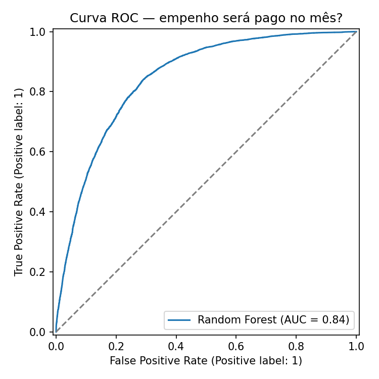
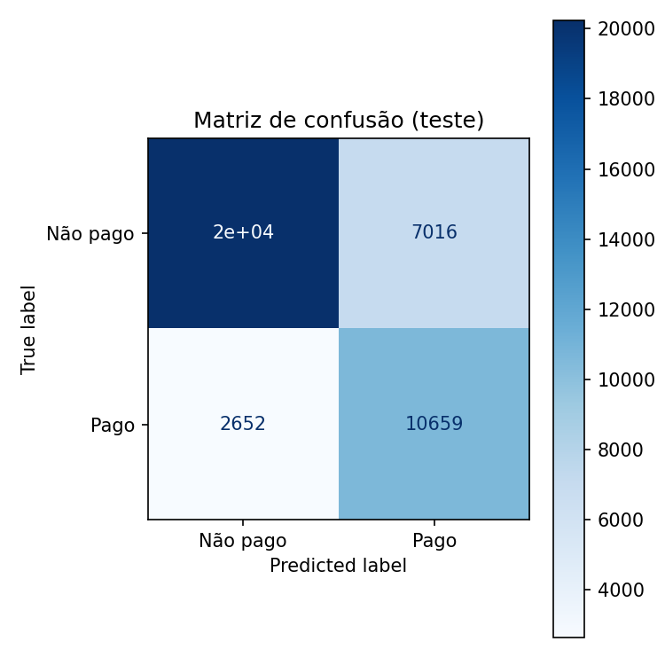
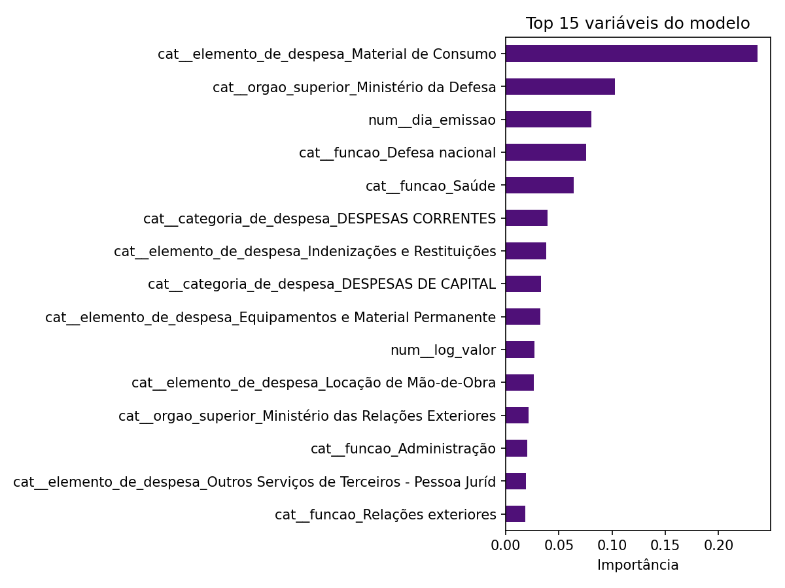

# Execução Orçamentária Federal — Agosto/2026

Projeto final EBAC × Semantix (Analista de Dados)
Autor: Johan Manochio · GitHub: [Ochion](https://github.com/Ochion)

**Dashboard (Looker Studio):** [Abrir dashboard](https://datastudio.google.com/reporting/12a3e0c7-f740-4e62-9580-958aa2e74560)

---

## 1. O problema

O orçamento público federal movimenta centenas de bilhões de reais por mês, mas o cidadão tem dificuldade de saber **quanto do que foi comprometido (empenhado) realmente chega à fase de liquidação e pagamento**, e quais órgãos e tipos de despesa concentram esse dinheiro.

**Por que dados ajudam:** cruzar as etapas da despesa (empenho → liquidação → pagamento) permite medir a eficiência da execução, identificar concentração de gastos, detectar anomalias (empenhos simbólicos, outliers) e dar transparência ao uso do recurso público.

**Pergunta central:** como o gasto federal de agosto/2026 se distribui por órgão, categoria e etapa de execução, e onde há gargalos entre empenho e pagamento?

---

## 2. Coleta de dados

| Item | Detalhe |
|---|---|
| Fonte | [Portal da Transparência — Despesas](https://portaldatransparencia.gov.br) (dados abertos, públicos e não confidenciais) |
| Período | 01/08/2026 a 31/08/2026 (31 arquivos diários) |
| Tipo | Estruturado (CSV) |
| Acesso | Download direto dos arquivos diários |
| Tabelas usadas | Empenho, Liquidação, Pagamento, Liquidação_EmpenhosImpactados, Pagamento_EmpenhosImpactados |

**Volumes após concatenar o mês:**

| Tabela | Linhas |
|---|---|
| Empenho | 205.382 |
| Liquidação | 511.943 |
| Pagamento | 777.939 |
| Liquidação × Empenhos | 589.428 |
| Pagamento × Empenhos | 814.778 |

**Observações de qualidade**
- 4 códigos de empenho duplicados entre dias → mantida a ocorrência do arquivo mais recente (base final: **205.378 empenhos**).
- Pagamentos existem em 23 dos 31 dias: as datas sem arquivo são fins de semana (sem processamento bancário), não falha de download.

---

## 3. Modelagem e tratamento

**Pipeline:** CSVs diários → Python/pandas (concatenação, limpeza, cruzamento) → base tratada → BigQuery → Looker Studio. O modelo preditivo foi executado no Google Colab (`notebooks/modelo_pagamento.ipynb`).

**Tratamento**
- Padronização de espaços em branco (ex.: 199.455 valores em "Observação").
- Datas convertidas para ISO.
- Nomes de colunas em snake_case (15 colunas finais).
- Colunas derivadas: `estorno_cancelamento` e `situacao_execucao`.

**Modelo de dados (BigQuery):** tabela `gastos_publicos_agosto_2026.execucao_orcamentaria` — 205.378 linhas, uma por empenho, já com valor liquidado e pago agregados.

**Análises exploratórias (5)**
1. Distribuição dos valores (histograma; mediana R$ 4.000, assimetria à direita)
2. Outliers por IQR (15,32% dos empenhos)
3. Ranking por órgão
4. Correlação empenhado × pago (Pearson = 0,6585)
5. Série temporal diária

**Modelo preditivo: o empenho será pago no mesmo mês?**

- **Alvo:** `pago = valor_pago > 0` (32,8% dos empenhos). Base de modelagem: 202.784 empenhos (removidos 2.594 estornos/cancelamentos, valor ≤ 0). Split estratificado: 162.227 treino / 40.557 teste.
- **Variáveis (apenas informação conhecida na emissão, para evitar vazamento):** órgão superior, categoria de despesa, elemento de despesa, função, valor original (log), dia do mês e dia da semana da emissão. Não foram usados valor liquidado, percentuais nem situação da execução, pois revelariam o alvo.
- **Modelos comparados (validação cruzada, 3 folds, ROC-AUC):** Regressão Logística 0,8329 vs. Random Forest 0,8441 → Random Forest escolhido.

| Métrica (teste) | Random Forest | Referência |
|---|---|---|
| ROC-AUC | **0,8446** | 0,50 (aleatório) |
| Acurácia | 76,2% | 67,2% (sempre prever "não pago") |
| Recall (pago) | 80,1% | |
| Precisão (pago) | 60,3% | |
| F1 | 0,688 | |

**Leitura:** o modelo supera com folga o baseline e encontra 4 em cada 5 empenhos que serão pagos. Em contrapartida, tem precisão moderada (cerca de 4 em cada 10 "pagos" previstos não são pagos no mês), o que o torna mais útil para **priorizar monitoramento** do que para decisões automáticas.

**Principais variáveis (importância no Random Forest):** elemento de despesa "Material de Consumo" (0,237), Ministério da Defesa (0,102), dia de emissão (0,080), função Defesa nacional (0,075) e Saúde (0,064). A importância indica o peso da variável, não a direção do efeito.

**Matriz de confusão (teste, 40.557 empenhos):** 20.230 verdadeiros negativos, 7.016 falsos positivos, 2.652 falsos negativos e 10.659 verdadeiros positivos.

| Curva ROC | Matriz de confusão |
|---|---|
|  |  |



**Visualizações (Looker Studio):** barras (top órgãos), linha (série temporal), dispersão (elemento de despesa, escala log), rosca (situação da execução), tabela dinâmica (órgão × categoria), com filtros de período, órgão e situação.

**Estrutura do repositório**
```
├── README.md
├── concatenar.py              # junta os 31 arquivos diários
├── exploracao.py, cruzamento.py, cruzar.execução.py
├── investigar.py, investigar.empenhos.simbolicos.py
├── eda.py                     # análise exploratória (5 análises)
├── tratamento_fase3.py        # limpeza e colunas derivadas
├── subir_bigquery.py          # carga da base tratada no BigQuery
├── modelo_pagamento.py        # modelo preditivo (Random Forest)
├── notebooks/                 # modelo_pagamento.ipynb (Colab, com saídas)
├── saidas_modelo/             # roc.png, matriz_confusao.png, importancia_variaveis.png, metricas.json
├── imagens/                   # prints do dashboard
└── relatorio/                 # relatório final (Word/PDF)
```
Os CSVs de dados não são versionados (`.gitignore`) por causa do tamanho; baixe os arquivos diários no Portal da Transparência.

---

## 4. Conclusões

- **Total empenhado:** R$ 696,98 bi · **liquidado:** R$ 436,56 bi (62,6%) · **pago:** R$ 428,27 bi (61,4%).
- **Concentração:** o Ministério da Fazenda lidera (R$ 426,56 bi), puxado pela rolagem da dívida mobiliária, com pico de R$ 387 bi em 27/08. Análises por órgão devem ser lidas com e sem a dívida.
- **Despesas Correntes** (R$ 385,83 bi) superam as de **Capital** (R$ 311,14 bi).
- **Gargalo de execução:** dos 205.378 empenhos, 116.740 estavam sem execução no fim do mês, 19.507 liquidados aguardando pagamento, 27.029 pagos parcialmente e 39.508 pagos integralmente.
- **Empenhos simbólicos:** 531 empenhos (≤ R$ 100) tiveram pagamento muito maior, ligados a folha e serviço da dívida (empenho estimativo/global); somam só 0,24% do valor pago.
- **Correlação moderada (0,66)** entre empenhado e pago indica que o valor empenhado, sozinho, não prevê o pagamento no mesmo mês.
- **Modelo preditivo:** com apenas informações da emissão, um Random Forest prevê se o empenho será pago no mês com ROC-AUC de 0,84 e recall de 80%, bem acima do baseline (acurácia 76,2% vs. 67,2%). O tipo de despesa (Material de Consumo), o órgão (Defesa) e a função pesam mais que o valor, o que sugere que o **perfil da despesa** determina o ritmo de pagamento mais que o montante.

**Sugestões**
- Monitorar a razão liquidado/empenhado por órgão como indicador de eficiência.
- Analisar separadamente dívida, folha e despesas discricionárias.
- Acompanhar empenhos liquidados sem pagamento como fila de risco de atraso.

**Limitações:** recorte de um único mês (sem sazonalidade); empenhos podem ser liquidados/pagos em meses seguintes, então "sem execução" não significa inexecução. No modelo, o "dia de emissão" tem peso em parte porque empenhos emitidos no fim do mês tiveram menos tempo para serem pagos (efeito de janela de observação), e não por uma regra de negócio. Um modelo mais robusto usaria vários meses e acompanharia cada empenho por um prazo fixo (ex.: 30 dias após a emissão).